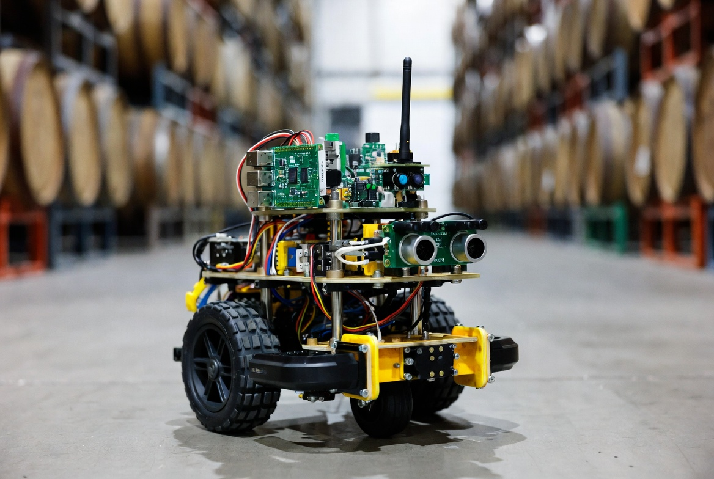
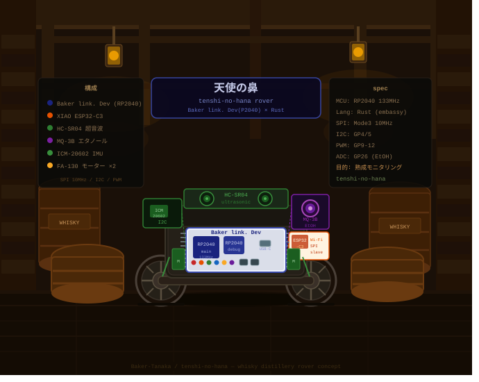
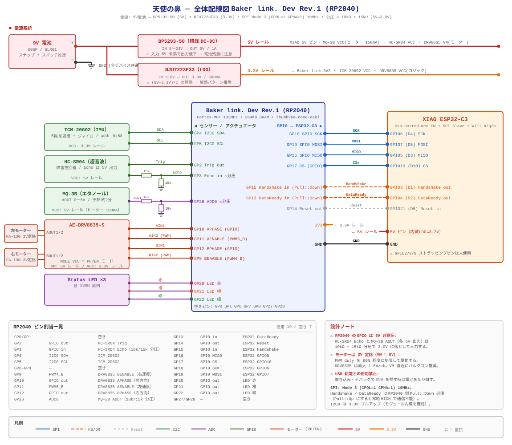

# 天使の鼻 - ROS2 × Baker link. Dev × ローバー

> ⚠️ 本プロジェクトは現在開発途中です。機能、配線、ドキュメントは変更される可能性があります。

**ROS 2 / Nav2 から遠隔操作できる 2WD ローバー。**

## イメージ画像





> English README is available at `README.md`.

## 概要
天使の鼻は、Baker link. Dev Rev.1 (RP2040) 基板を中心に構成された 2輪ローバーです。蒸留所や熟成庫を巡回し、エタノール蒸気濃度を測定し、磁界センサーで樽内の液面の変化を推定します。

本プロジェクトは以下を組み合わせています。
- **micro_xrce_dds_rs** と **micro-ROS Agent** による ROS2 互換メッセージング
- **XIAO-ESP32-C3 の Wi-Fi / ESP-hosted MCU**
- **Embassy-rs no_std 非同期ランタイム**
- **micro_xrce_dds_rs** と **micro-ROS Agent** による ROS2 互換メッセージング

## 主な特徴
- エタノール蒸気を検知し「天使の分け前」を間接的に監視
- 浮遊磁石＋磁界検出で樽内液面を非接触測定
- 6軸 IMU (ICM-20602) による odom / 姿勢推定
- XIAO-ESP32-C3 で Wi-Fi 通信を実現
- 低コストかつ no_std 組み込み設計

## ハードウェア構成
2026年4月時点の日本国内向け概算です。

| 部品                 | 例                                                                   | 価格目安 | 購入先                                                              | 備考                                       |
| -------------------- | -------------------------------------------------------------------- | -------- | ------------------------------------------------------------------- | ------------------------------------------ |
| 2WD ロボットシャーシ | 2WD Mini Smart Robot Mobile Platform Kit                             | ¥1,900   | [秋月電子](https://akizukidenshi.com/catalog/g/g113651/)            | FA-130 系 3V 定格ギヤモーター×2 付属       |
| Baker link. Dev      | Rev. 1                                                               | ¥1,980   | [スイッチサイエンス](https://www.switch-science.com/products/10044) | メイン MCU、Embassy-rs 対応                |
| モータドライバ       | AE-DRV8835-S（DRV8835 ステッピング&DC モータードライバーモジュール） | ¥400     | [秋月電子](https://akizukidenshi.com/catalog/g/g109848/)            | PH/EN モード（MODE ピンを VCC へ）         |
| IMU                  | ICM-20602 Breakout Board                                             | ¥990     | [スイッチサイエンス](https://www.switch-science.com/products/8695)  | 6軸（加速度+ジャイロ）、I2C addr 0x68      |
| エタノールセンサー   | MQ-3B / MQ-3 モジュール                                              | ¥450     | [秋月電子](https://akizukidenshi.com/catalog/g/g116269/)            | 天使の分け前検知。ヒーターは 5V/150mA      |
| 超音波センサー       | HC-SR04                                                              | ¥300     | [スイッチサイエンス](https://www.switch-science.com/products/8224/) | 障害物回避用（5V デバイス）                |
| 3.3V レギュレーター  | NJU7223F33（3.3V 500mA LDO）                                         | ¥80      | [秋月電子](https://akizukidenshi.com/catalog/g/g100432/)            | 9V → 3.3V レール（ロジック系）             |
| 5V レギュレーター    | BP5293-50（5V 1A DC-DC）                                             | ¥240     | [秋月電子](https://akizukidenshi.com/catalog/g/g111188/)            | 9V → 5V レール（モーター・MQ-3B・HC-SR04） |
| 電池                 | 9V 電池 (006P) + スナップ                                            | ~¥500    | —                                                                   | 両レギュレーターへ給電。電源スイッチ推奨   |
| 分圧抵抗             | 10kΩ + 15kΩ ×2 組                                                    | < ¥20    | —                                                                   | MQ-3B AOUT / HC-SR04 Echo（5V）を 3.0V 化  |

## 配線図



### 電源系統

```
9V 電池 (006P)
  ├── BP5293-50  → 5V レール   : XIAO 5V ピン、MQ-3B VCC（ヒーター）、HC-SR04 VCC、DRV8835 VM
  └── NJU7223F33 → 3.3V レール : Baker link. Dev 3V3、ICM-20602 VCC、DRV8835 VCC（ロジック）
```

> - 書き込み・デバッグで **USB を接続する時は電池を切り離す** こと。
> - BP5293-50 は **入力 8V 以上** が必要。9V 電池の残量低下に注意。
> - NJU7223F33 は (9V−3.3V)×負荷電流 の発熱がある。3.3V 系の負荷を軽く保ち、放熱パターンを確保する。

### 信号レベル（5V → 3.3V）

RP2040 の GPIO は **5V 非耐圧**。以下の 2 信号は **10kΩ + 15kΩ の分圧**（5V → 3.0V）が必須:

- **MQ-3B AOUT → GP26 (ADC0)** — AOUT は最大 ~5V。電源投入後 約2分の予熱が必要（ファームウェアが予熱中の publish を抑制）。
- **HC-SR04 Echo → GP3** — Echo は 5V パルスを出力。

### モーター駆動

キット付属モーターは **3V 定格** に対し DRV8835 の VM は 5V レールから給電するため、
ファームウェア側で PWM duty を **~60%** に制限して実効電圧を 3V 相当に抑える
（DRV8835 は最大 1.5A/ch。VM 直近にバルクコンデンサ推奨）。

## 無線通信
- **XIAO-ESP32-C3** を ESP-Hosted MCU として使用
- `external/embassy` サブモジュールに含まれる `embassy-net-esp-hosted` を利用

## ソフトウェア構成
- `micro_xrce_dds_rs` と micro-ROS Agent
- カスタムメッセージ `angel_nose_msgs`（エタノール濃度、液面高さ、環境データ）

## 設置・運用の流れ
## ROS 2 インターフェース

| 方向 | トピック            | 型                    | 用途                    |
| ---- | ------------------- | --------------------- | ----------------------- |
| 購読 | `/cmd_vel`          | `geometry_msgs/Twist` | 速度指令                |
| 配信 | `/imu/data`         | `sensor_msgs/Imu`     | 加速度・角速度          |
| 配信 | `/ultrasonic/front` | `sensor_msgs/Range`   | HC-SR04 前方障害物距離  |
| 配信 | `/odom`             | `nav_msgs/Odometry`   | open-loop 姿勢・速度    |
| 配信 | `/tf`               | `tf2_msgs/TFMessage`  | `odom` から `base_link` |

メッセージ時刻は micro-ROS Agent と同期します。姿勢推定は行わず、車輪エンコーダがないためオドメトリは open-loop です。高精度な Nav2 運用には外部自己位置推定を併用してください。

## RViz2・Nav2 の起動

`.docker/Dockerfile` の変更を反映するため開発コンテナを再ビルドし、ROS 2 ホストパッケージをビルドします。

```sh
cd ros2_ws
colcon build --symlink-install
source install/setup.bash
```

ローバーと micro-ROS Agent の接続後、地図を使わない odom 基準モードを起動します。

```sh
ros2 launch tenshi_no_hana_bringup bringup.launch.py localization_mode:=odom
```

このモードは短距離・低速の相対目標用です。最初は車輪を浮かせて RViz2 の **2D Goal Pose** を試し、床上では 0.25〜0.5 m の目標から確認してください。Nav2 のキャンセルまたは速度出力停止後、ファームウェアの watchdog が 500 ms 以内にモーターを停止します。

既知地図上の走行には、2D LaserScan を出力する LiDAR と map YAML が必要です。

```sh
ros2 launch tenshi_no_hana_bringup bringup.launch.py \
  localization_mode:=amcl map:=/absolute/path/to/map.yaml scan_topic:=/scan
```

HC-SR04 の検出範囲は機体前方の狭い範囲だけです。近距離障害物の検出には使えますが、自己位置推定、SLAM、全周衝突防止で LiDAR を代替できません。また、現在の odometry はエンコーダを持たず指令速度を積分するため、位置誤差が累積します。costmap を実運用する前に `urdf/tenshi_no_hana.urdf.xacro` の仮寸法を実測値へ変更してください。

## 今後の拡張
- 車輪エンコーダまたは外部自己位置推定の追加
- 自律マッピングと複数ローバー対応

## ESP32-Hosted (ESP32-C3) ピン割り当て
現在の `sdkconfig` に基づくピン配置です。

> 参考: [Seeed Studio XIAO ESP32C3 Getting Started](https://wiki.seeedstudio.com/XIAO_ESP32C3_Getting_Started/)

### XIAO ESP32C3 GPIO ↔ ピン対応

| XIAO ピン | GPIO   | 標準機能  | 備考                               |
| --------- | ------ | --------- | ---------------------------------- |
| D0        | GPIO2  | ADC       | ⚠️ ストラッピングピン               |
| D1        | GPIO3  | ADC       |                                    |
| D2        | GPIO4  | ADC       | MTMS (JTAG)                        |
| D3        | GPIO5  | ADC       | MTDI (JTAG)                        |
| D4        | GPIO6  | SDA (I2C) | FSPICLK, MTCK (JTAG)               |
| D5        | GPIO7  | SCL (I2C) | FSPID, MTDO (JTAG)                 |
| D6        | GPIO21 | UART TX   |                                    |
| D7        | GPIO20 | UART RX   |                                    |
| D8        | GPIO8  | SPI SCK   | ⚠️ ストラッピングピン               |
| D9        | GPIO9  | SPI MISO  | ⚠️ ストラッピングピン / BOOT ボタン |
| D10       | GPIO10 | SPI MOSI  | FSPICS0                            |

### 推奨 esp-hosted Slave 配線

> GPIO2/8/9 のストラッピングピンは避ける設計です。

| 信号       | GPIO   | XIAO ピン | 用途           |
| ---------- | ------ | --------- | -------------- |
| SPI MOSI   | GPIO7  | D5        | 必須           |
| SPI MISO   | GPIO5  | D3        | 必須           |
| SPI CLK    | GPIO6  | D4        | 必須           |
| SPI CS     | GPIO10 | D10       | 必須           |
| Handshake  | GPIO3  | D1        | タイミング同期 |
| Data Ready | GPIO4  | D2        | データ到着通知 |
| Reset      | GPIO21 | D6        | 推奨           |

#### 変更点

| 信号     | 旧 GPIO     | 新 GPIO      | 理由                     |
| -------- | ----------- | ------------ | ------------------------ |
| SPI MISO | GPIO2（D0） | GPIO5（D3）  | ストラップピンの回避     |
| Reset    | なし        | GPIO21（D6） | ホストリセット制御を追加 |

#### 空きピン

| XIAO ピン | GPIO   | 備考                   |
| --------- | ------ | ---------------------- |
| D0        | GPIO2  | 予備だがストラップピン |
| D7        | GPIO20 | デバッグ用 UART RX     |
| D8        | GPIO8  | 予備だがストラップピン |
| D9        | GPIO9  | BOOT ボタンに注意      |

### ESP-IDF menuconfig 設定

```powershell
idf.py menuconfig
```

**Example Configuration → Bus Config → SPI Full-Duplex Configuration** で次を設定します:

| 設定項目          | 値  |
| ----------------- | --- |
| SPI MOSI (GPIO)   | 7   |
| SPI MISO (GPIO)   | 5   |
| SPI CLK (GPIO)    | 6   |
| SPI CS (GPIO)     | 10  |
| Handshake (GPIO)  | 3   |
| Data Ready (GPIO) | 4   |
| Reset pin (GPIO)  | 21  |

保存後にビルドします。

```bash
# esp-hosted-mcu の slave サンプル作成
idf.py create-project-from-example "espressif/esp_hosted:slave"
cd slave
idf.py set-target esp32c3
idf.py menuconfig
# MISO=5, MOSI=7, CLK=6, CS=10, HS=3, DR=4
# Reset GPIO=21
idf.py build flash
```

## サブモジュールセットアップ

RP2040 側の依存はサブモジュールで管理します。

```bash
git submodule update --init --recursive external/embassy external/micro_xrce_dds_rs
```
